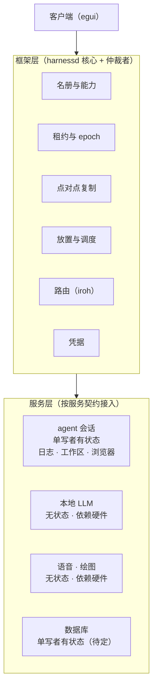
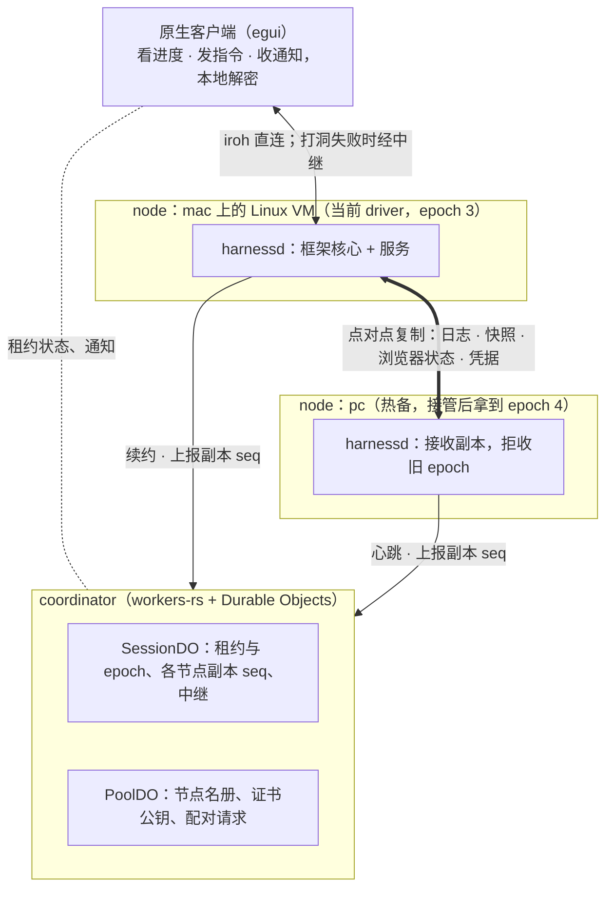

# 概览

## 背景与目标

目标：把自己的设备组成一个 agent 环境池，跑 agent 时像在一台机器上。**只有一台设备时功能完整可用**；有两台以上时，任一节点掉线，另一台在约 30 秒内从最近一轮的检查点接着跑。客户端随时能看进度、下指令。

项目分两层：**框架**负责在设备之间同步和调度，**服务**负责干具体的活（agent 会话、模型、数据库等）。见下文「总体架构」和[服务模型](10-services.md)。

全部用 Rust 实现。agent 循环、模型客户端和对话压缩用 goose 的 GDK（`goose-agent`、`goose-providers`、`goose-context-management`）；会话日志、工具、复制、租约自己写，不依赖 pi-durable 和 chord sync。seq 加 epoch 的单写者模型借鉴 chord sync，`requestId` 去重借鉴 pi-durable，提示词和工具设计参考 goose、pi 和 Hermes。

### MVP 目标

- **单机完整可用**：只有一台设备、不配置 Cloudflare、甚至断网时，agent、检查点、崩溃恢复、浏览器、客户端都正常工作（云端模型除外）。见下文「部署形态」。
- **自动替补**：有多台设备时，driver 掉线，热备节点自动接管，最多重做一个工具调用。
- **环境一致**：所有任务都在同一个 Linux OCI 镜像里跑。mac 也是在 Linux VM 里作为节点。
- **浏览器**：给 agent 一个浏览器，登录状态和打开的页面跨机器同步，见[浏览器](03-browser.md)。
- **可用本地小模型**：模型提供方可以配成本机的 Ollama 或任意 OpenAI 兼容端点，例如 Qwen 系列 0.8B–4B 的小模型，用于离线兜底和杂活。见[端侧模型服务](06-local-models.md)。
- **凭据同步**：池内节点共享凭据，陌生机器要经过验证才能入池。
- **客户端**：原生 Rust 桌面程序，不套浏览器，用来看进度、发指令、收通知。
- **不依赖 Radius**：多机时 coordinator 部署在你自己的 Cloudflare 账号下。已决定接受对 Cloudflare 的依赖，它就算是单点，也比个人设备可靠。但会话内容不上云，只在自己的节点之间同步。
- **纯 Rust**：节点侧只有一个 `harnessd` 二进制，coordinator 用 workers-rs 编译成 WASM。这只约束我们自己写的程序：agent 在容器里用什么语言和工具都不限，服务的推理后端也不限。

### MVP 非目标

- macOS 原生任务（Xcode 等）。
- 多台机器同时写同一个会话：冲突时把会话拆开，不做合并。
- 迁移运行中的进程和内存状态（包括浏览器页面里的 JS 状态）。
- 通用的服务框架：MVP 只实现 agent 会话这一个有状态服务，框架和服务的边界在代码里划清，但通用接口等第二个有状态服务出现时再提炼。
- 按任务路由模型、跨节点的模型服务（语音、绘图），放到 MVP 之后。
- Hermes 的体验层（消息网关、学习循环、cron），放到 MVP 之后。
- 建模页：带 3D 视口、由 agent 建模的专门页面，放到 MVP 之后。
- 手机端。

## 术语

| 术语 | 含义 |
| --- | --- |
| pool（池） | 一组互相信任的节点，加一个仲裁者。一个人通常只有一个池。单机时池里只有一个节点。 |
| node（节点） | 池里的一台 Linux 机器，或者 mac 上的 Linux VM。节点上跑 `harnessd` 守护进程。 |
| 框架 | 管理节点和服务的那一层：名册、租约、复制、放置、路由、凭据、通知。 |
| 服务 | 跑在节点上、干具体活的东西，按[服务契约](10-services.md)接入框架。agent 会话是第一个服务。 |
| 仲裁者（arbiter） | 发租约、维护名册的逻辑。单机时内置在 harnessd 里（本地仲裁）；多机时跑在 Cloudflare 上（coordinator）。两者是同一份代码。 |
| coordinator | 多机时的仲裁者：跑在 Cloudflare 上的服务（Workers + Durable Objects），不需要自己的服务器。只负责仲裁租约、维护节点名册、为客户端中继加密流量，不存任何会话内容。 |
| session（会话） | agent 会话服务的一个实例：一条只追加的会话日志（seq 单调递增），加一个工作区和一份浏览器状态。 |
| driver | 此刻写某个有状态服务实例（如某个会话）的那个节点。同一时刻只有一个 driver。 |
| standby（热备） | 直接从 driver 接收副本、随时可以接管的节点。 |
| lease（租约） | 仲裁者发给 driver 的写权限，有过期时间，要靠心跳续期。 |
| epoch | 每发一次租约加 1 的整数，作为防旧 driver 的令牌。 |
| checkpoint（检查点） | 一个会话 seq 加上对应时刻的工作区快照和浏览器状态，是恢复和替补时的起点。 |

### seq 加 epoch 的单写者模型

同一个有状态服务实例任一时刻只允许一个节点写（单写者）。每条记录带两个编号：

| 编号 | 何时加 1 | 谁分配 | 用途 |
| --- | --- | --- | --- |
| seq | 每写一条记录 | 当前 driver | 定顺序；热备按 seq 断点续传 |
| epoch | 每换一次写者 | 仲裁者发租约时 | 认身份；拒收旧写者的数据 |

只有一个写者，记录天然是一条直线，不需要 CRDT 或合并。换写者时，旧 driver 可能没死透（只是断网），恢复后还会发数据；热备看到 epoch 小于当前值就拒收。这与 Raft 的 term + log index、Kafka 的 leader epoch + offset 是同一个模型。

## 总体架构

### 两层

- **框架层**不知道服务内部是什么，只看每个服务声明的契约：状态类型、放置约束、接口、钩子、外部副作用分类。它负责名册与能力、租约与 epoch、点对点复制、放置与调度、路由、凭据和通知。
- **服务层**是具体干活的东西。MVP 只有 agent 会话这一个有状态服务；本地 LLM 在 MVP 里只作为模型提供方的一个配置项。详见[服务模型](10-services.md)。
- 代码上，框架层的 crate 不依赖 goose；goose 只出现在 agent 会话服务里。

### 部署形态

| 形态 | 仲裁者 | 需要 Cloudflare | 能力 |
| --- | --- | --- | --- |
| **单机** | 本地仲裁，内置在 harnessd 里，状态存本地 SQLite | 否 | 除替补和复制外全部可用：检查点、崩溃恢复、浏览器、本地模型、客户端 |
| **多机** | coordinator，跑在 Cloudflare Durable Objects 里 | 是 | 全部，包括自动替补 |

仲裁逻辑（租约状态机、epoch、名册）写在一个不依赖运行时的 crate 里，同一份代码在单机时编进 harnessd，在多机时编译成 WASM 跑在 DO 里。从单机升级到多机：创建 coordinator，把本地的 epoch 和名册迁过去，之后流程和多机一致。

单机时只有一个节点，租约永远归它，epoch 只在 harnessd 重启时加 1。外部操作不用等副本确认，客户端提示"单机，没有副本"。

### 多机架构

系统分三部分：仲裁者（多机时是 Cloudflare 上的 coordinator），每台节点上一个 Rust 写的 `harnessd`，以及一个原生客户端。三部分都用 Rust 写，框架核心和服务都在 harnessd 里。Cloudflare 只管"谁能写"：租约、名册和中继。"写了什么"，即会话日志、工作区快照、浏览器状态和凭据密文，只在节点之间点对点同步，不上云。

替补时，Cloudflare 把租约交给副本最新的节点。

| 组件 | 语言 | 自己写的部分 | 直接复用的部分 |
| --- | --- | --- | --- |
| 仲裁逻辑 | Rust，不依赖运行时 | 租约状态机、epoch、名册；单机时编进 harnessd，多机时编进 coordinator | — |
| coordinator | Rust（workers-rs，编译为 WASM） | 把仲裁逻辑接到 DO 存储和 alarm 上；客户端中继 | Durable Objects |
| harnessd · 框架核心 | Rust | 心跳与续约、点对点复制（会话批次、git 快照、浏览器状态、凭据密文）、放置、路由、容器管理、凭据注入 | iroh（P2P QUIC）、git、podman、redb |
| harnessd · agent 会话服务 | Rust | 会话日志、工具、TUI、快照与还原、接管时的恢复逻辑、`git`/`gh` 包装的后端 | goose-agent、goose-providers、goose-context-management、ratatui |
| 客户端 | Rust 原生（egui + wgpu） | 桌面界面，作为 iroh 节点直连节点，在本地解密 | 无 |

Cloudflare 上只有两类 Durable Object：

- **SessionDO**：每个有状态服务实例（如每个会话）一个。存租约、epoch 和各节点上报的副本 seq；客户端打洞失败时为它中继。中继的是端到端加密的数据，不落盘。DO 内部单线程执行，仲裁天然是串行的。
- **PoolDO**：整个池一个。存节点名册、节点能力、证书公钥和配对请求。

节点之间用 iroh 组网，它能打洞穿透 NAT，打不通时走中继。agent 循环基于 goose-agent 的状态机，跑在 harnessd 里，每个会话一个 tokio 任务，只在节点持有该会话的租约时运行。工具调用通过 `podman exec` 在该会话的容器里执行，一个会话对应一个容器。

### 为什么用 goose-agent

它的状态机每走一步都从持久化的会话重新读状态，内存里不缓存。另一台机器拿到同一份会话日志，就能从同一个位置接着走。

- 实现它的 `SessionLoader` 和 `EffectHandler`，背后是我们带 seq 和 epoch 的会话日志。`EffectHandler` 落盘工具结果时，把 `workspace = T`（以及浏览器状态的 hash）写进同一个批次。
- 工具用 rmcp 接入，全是我们写的：经 `podman exec` 在容器里执行，外部操作在工具内部拦截。意图和完成标记用 `set_message_meta` 记在消息上。
- 会话日志的外层格式自己定义，goose 的 `Message` 只是记录里的内容。升级或换掉 GDK，都不用迁移日志。
- goose-providers 自带 Ollama、OpenAI 兼容等提供方，本地小模型可以直接接入。
- GDK 目前是 `0.1.0-alpha.13`（Apache-2.0），锁定版本使用，见[未决问题](08-open-questions.md)。
