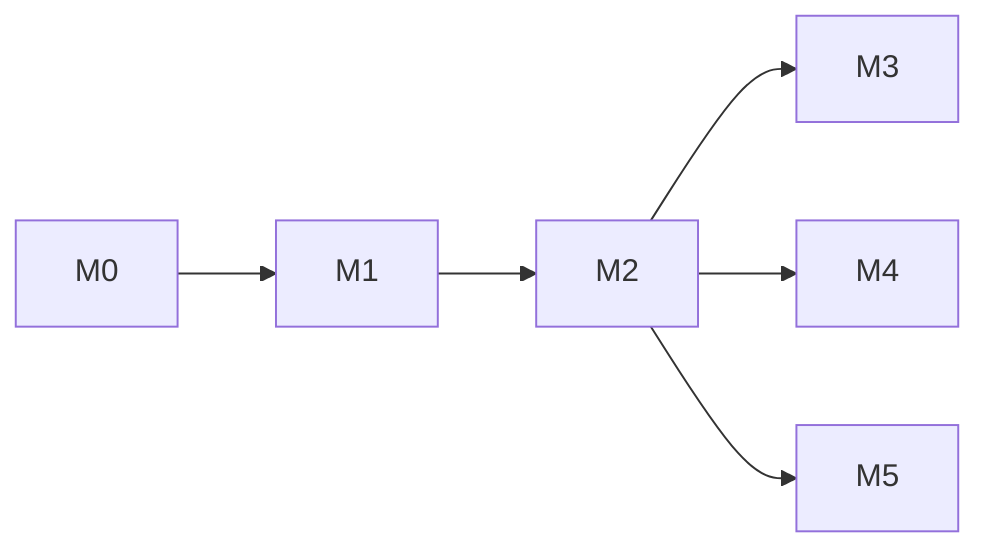

# MVP 里程碑

MVP 分六步，每一步都有一个能自动化的验收门槛。过不了门槛就不进入下一步。没有定日期。自动替补放在 M3，前三步先打好单机和副本的基础。

| 里程碑 | 做什么 | 验收门槛 |
| --- | --- | --- |
| **M0 单机 agent** | goose-agent 接自己的会话日志，写工具和 TUI；不进容器，在宿主机上直接跑 | 随机 `kill -9` 100 次，不重复执行，不丢已提交记录 |
| **M1 单节点可恢复** | 工具在容器里执行，每次调用打 git 快照；容器里跑 Chromium，检查点导出浏览器状态；`kill -9` 后从检查点继续 | 随机 kill 100 次，会话、工作区、浏览器登录状态始终一致 |
| **M2 节点间复制** | 自定义复制协议，git 快照和浏览器状态直接推送；iroh 组网，节点重连后自动追平 | 热备在每个 seq 上与 driver 逐字节一致 |
| **M3 自动替补（核心）** | 租约、epoch、替补、分叉、主动交接；外部副作用的意图记录与核对；接管时恢复浏览器 | 断开 mac 网络后 30 秒内 pc 接管，最多重做 1 次调用；mac 上登录过的网站，pc 接管后不用重新登录 |
| **M4 入池与凭据** | 配对码批准，DEK 分发；按任务注入凭据，吊销节点 | 未批准节点拿不到密钥；吊销后旧 DEK 失效 |
| **M5 原生客户端** | egui 界面、指令收件箱、系统通知；配对与本地密钥，iroh 直连；浏览器画面串流与人工登录 | 客户端收到替补通知，并能发指令让 pc 继续 |

M4 和 M5 只依赖 M2，可以和 M3 并行做。M3 的门槛要用故障注入来跑：随机断网、kill 进程、重启 coordinator，各重复上百次，然后核对没有数据损坏。

MVP 之后：端侧模型服务、建模页、手机端、Hermes 体验层（消息网关、学习循环、cron）。
