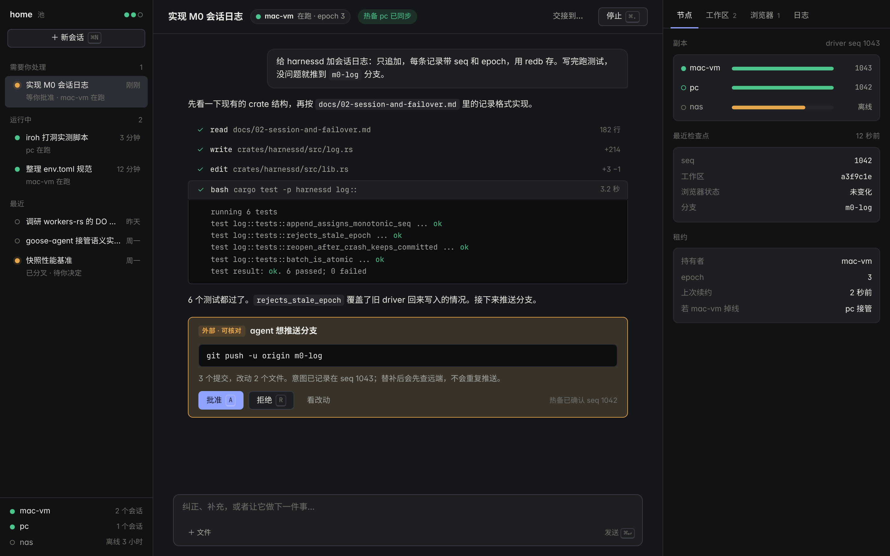
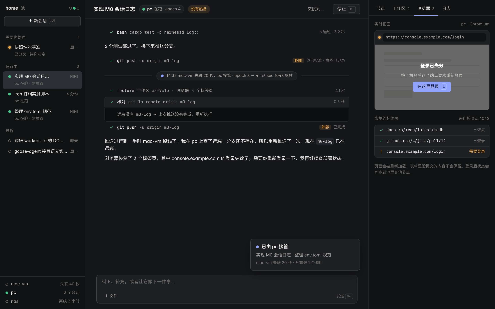
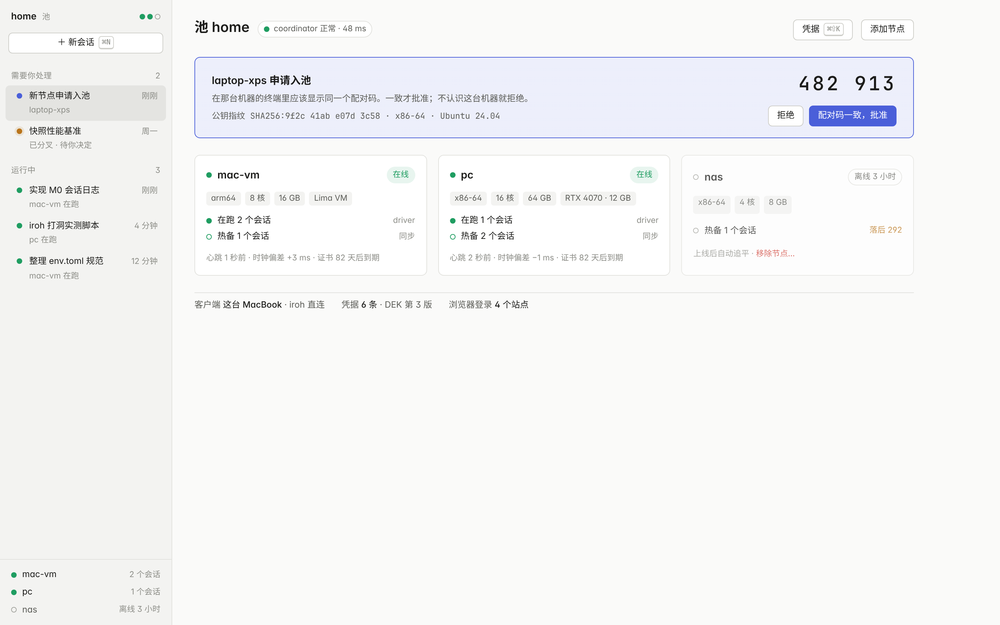

# 客户端界面设计

原生桌面客户端（egui + wgpu）的界面规范。功能范围见[客户端](05-client.md)，这里只管长什么样、怎么交互。

界面稿在 [`docs/ui/`](ui/)：PNG 是渲染结果，`docs/ui/mockups/` 里的 HTML 和 `tokens.css` 是源文件，数值以 `tokens.css` 为准。重新渲染：`node docs/ui/mockups/render.js docs/ui`（需要 Playwright）。HTML 只是画稿，不是实现方式。

| 稿 | 场景 |
| --- | --- |
|  | **01 会话主界面**（深色）：agent 在 mac-vm 上跑，等你批准一次推送 |
|  | **02 替补之后**（深色）：mac-vm 掉线，pc 接管，浏览器登录失效等你处理 |
|  | **03 池概览**（浅色）：新节点申请入池，三台节点的状态 |

## 设计原则

1. **状态先于内容。** 谁在跑、有没有副本，永远在会话顶栏可见：`pc 在跑 · epoch 4`、`热备 pc 已同步` / `没有热备`。这是这个产品和普通聊天界面的根本区别。
2. **只在需要你时打扰。** 侧栏第一组永远是"需要你处理"（等批准、已分叉、入池申请、需要登录）。系统通知只发这几类事。
3. **内部操作安静，外部操作显眼。** 读写文件、跑测试折叠成一行，灰色；`git push`、发消息这类外部操作用琥珀色边框的卡片，带"外部 · 可核对/不可核对"标签，写清楚替补后会怎么处理。
4. **替补是事件，不是错误。** 在对话时间线里画一条中性的分隔（`14:32 mac-vm 失联 20 秒，pc 接管 · epoch 3 → 4`），配一条通知。不用红色，不弹模态框。真正的失败才用红色。
5. **键盘优先，密度适中。** 所有高频动作都有快捷键，按钮上直接标出来。字号 13.5，行高 1.55，不做大留白的"营销式"界面。

## 布局

三栏，窗口最小 1100 × 700。

| 区域 | 宽度 | 内容 |
| --- | --- | --- |
| 侧栏 | 248 | 池名和节点状态点 → 新会话 → 会话分组（需要你处理 / 运行中 / 最近）→ 底部节点迷你列表 |
| 主区 | 自适应，正文列最宽 760 居中 | 会话顶栏 → 对话时间线 → 输入框 |
| 检查器 | 368，可收起（`⌘\`） | 标签页：节点 / 工作区 / 浏览器 / 日志 |

窗口宽度不足 1280 时检查器默认收起，改为从右侧滑出覆盖主区。池概览页没有检查器。

### 会话顶栏

`标题` · `driver 芯片（状态点 + 节点名 + epoch）` · `副本芯片` · 右侧 `交接到…`、`停止 ⌘.`。副本芯片三种状态：绿色"热备 X 已同步"、琥珀色"热备 X 落后 N"、琥珀色"没有热备"。

### 对话时间线

| 元素 | 样式 |
| --- | --- |
| 用户消息 | 右对齐气泡，`bg-raised`，圆角 12/12/4/12 |
| agent 文字 | 左对齐，无底色 |
| 内部工具调用 | 一行 30 高：状态图标 · 工具名（等宽）· 参数（等宽，次要色，超长省略）· 右侧结果摘要（行数、耗时、`+214`）。点击展开输出 |
| 外部工具调用（已完成） | 同内部一行，右侧多一个琥珀色 `外部` 标签和"已完成 / 你已批准" |
| 待批准的外部调用 | 卡片：琥珀边框 + 淡琥珀底；标签 + 一句话标题；等宽命令框；一行说明（影响范围、意图记录在哪个 seq、替补后怎么处理）；`批准 A` `拒绝 R` `看改动`；右下角副本确认状态 |
| 替补 / 交接事件 | 居中胶囊 + 两侧细线，强调色圆点，一句话写清时间、谁失联、谁接管、epoch 变化、从哪个 seq 继续 |
| 恢复步骤 | 接管后的 `restore`、`核对` 当作普通工具调用显示，让你看到它确实查过 |

### 检查器

- **节点**：副本泳道（每个节点一行：状态点、名字、进度条、seq），是本产品的标志性元素。下面是最近检查点（seq、工作区 hash、浏览器状态、分支）和租约（持有者、epoch、上次续约、掉线后谁接管）。
- **工作区**：会话开始以来改过的文件，状态字母（M/A/D）+ 增删行数，点击看 diff。
- **浏览器**：实时画面（CDP screencast 帧作为纹理），地址栏带状态点；需要人工时画面上盖一层半透明遮罩和按钮（`在这里登录 L`），点击后键鼠事件转发给容器里的 Chromium。下面是恢复的标签页列表。
- **日志**：harnessd 的结构化日志，按会话过滤。

### 池概览

页头：池名、coordinator 状态（延迟）、`凭据`、`添加节点`。入池申请用强调色卡片置顶，配对码 28px 等宽大字，按钮文案写成"配对码一致，批准"，逼你真的去核对。节点卡片三列：名字、在线状态、硬件标签（架构、核数、内存、显卡）、在跑和热备的会话数、心跳、时钟偏差、证书到期。离线节点降低不透明度，显示落后多少，提供"移除节点…"。

## 设计 token

完整数值见 [`docs/ui/mockups/tokens.css`](ui/mockups/tokens.css)。要点：

- **配色**：中性灰底，表面越"浮"越亮（窗口 → 面板 → 卡片）。只有一个交互强调色（深色 `#8fa3ff`，浅色 `#4a5fd9`），用于按钮、焦点、选中标签、事件圆点。状态色只表达状态：绿 = driver / 已同步 / 成功，琥珀 = 需要你 / 落后 / 外部 / 已分叉，红 = 失败，灰 = 离线。
- **主题**：深色和浅色都要做，默认跟随系统。
- **字体**：界面用 Inter + 思源黑体（Noto Sans SC），代码和标识符用 JetBrains Mono。字号只有五档：11.5 / 12.5 / 13.5 / 15 / 20（配对码 28 是唯一例外）。
- **间距**：4 的倍数（4 / 8 / 12 / 16 / 24 / 32）。圆角：控件 6，卡片 8，用户气泡 12。
- **状态点**：8px。实心绿 = driver / 在线；空心绿 = 热备；实心琥珀带光圈 = 需要你；空心灰 = 离线；实心强调色 = 事件 / 申请。

## 快捷键

| 键 | 动作 |
| --- | --- |
| `⌘K` | 命令面板（切换会话、交接、打开任意面板） |
| `⌘N` | 新会话 |
| `⌘↵` | 发送 |
| `⌘.` | 停止当前回合 |
| `A` / `R` | 批准 / 拒绝当前待批准卡片（焦点不在输入框时） |
| `L` | 接管浏览器去登录 |
| `⌘1`–`⌘4` | 检查器标签页 |
| `⌘\` | 收起 / 展开检查器 |
| `⌘⇧K` | 凭据 |
| `↑` / `↓` | 侧栏里切换会话 |

Windows / Linux 上 `⌘` 换成 `Ctrl`。

## egui 实现要点

- **主题**：启动时按 token 构造 `egui::Visuals`（`panel_fill`、`window_fill`、`extreme_bg_color`、`widgets.*.bg_fill`、`selection`、`hyperlink_color` 等）和 `egui::Style`（`spacing.item_spacing`、`button_padding`、圆角）。跟随系统深浅色切换。
- **字体**：必须内置或从系统加载 CJK 字体，否则中文全是方块。字体回退顺序：Inter → Noto Sans SC；等宽：JetBrains Mono → Noto Sans Mono CJK SC。思源黑体体积大，可按常用字裁剪子集，或运行时从系统字体目录加载。
- **布局**：`SidePanel::left`（侧栏）、`SidePanel::right`（检查器，可调宽度）、`CentralPanel`（主区）；时间线用 `ScrollArea` 且 `stick_to_bottom`。需要可拖拽分屏时再引入 egui_dock。
- **自定义控件**：状态点、芯片、副本泳道、工具调用行、批准卡片、事件分隔都写成小函数，不要每处手搓。
- **浏览器画面**：把 CDP 截帧解码成 `ColorImage` 更新同一个 `TextureHandle`，限制在 10–15 fps；不可见时停止拉流。
- **动效**：克制。只用 `ctx.animate_bool` 做展开折叠和检查器滑出（约 120 ms），需要你处理的琥珀点可以有很慢的呼吸。替补发生时不做闪烁。
- **重绘**：空闲时不持续重绘；收到 iroh 推送的新事件再 `request_repaint`。
- **系统通知**：用平台原生通知（如 notify-rust），正文只写事件类型，不带会话内容。

## 空状态与边界情况

- **没有会话**：主区居中一句"让 agent 做点什么"和输入框，下面列出在线节点。
- **所有节点离线**：顶部一条琥珀横幅"所有节点都离线，只能看历史"，输入框禁用并说明原因。
- **连不上 coordinator**：顶栏芯片变琥珀"coordinator 不可达 · 不能替补，外部操作暂停"；会话照常显示。
- **会话已分叉**：时间线顶部一张卡片说明分叉点（`分叉自 S@1043`），给出"丢弃"和"作为新会话继续"。
- **只有一个节点在线**：副本芯片显示"没有热备"，外部操作卡片里补一句"当前没有副本，替补后可能需要你确认"。
